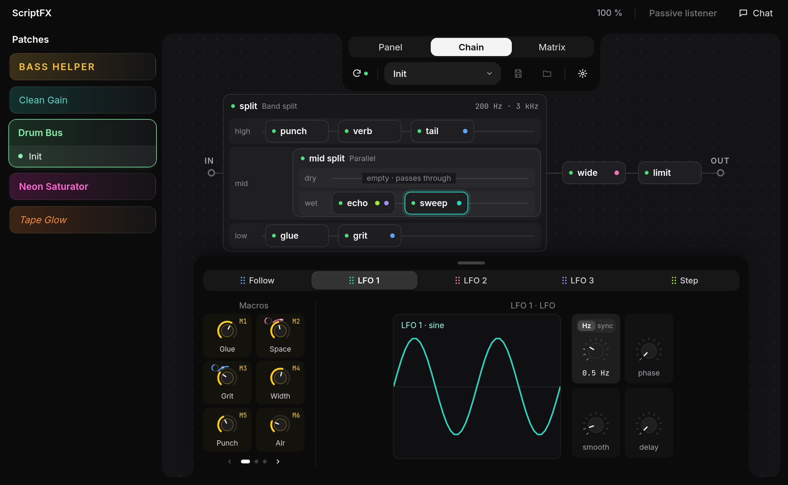
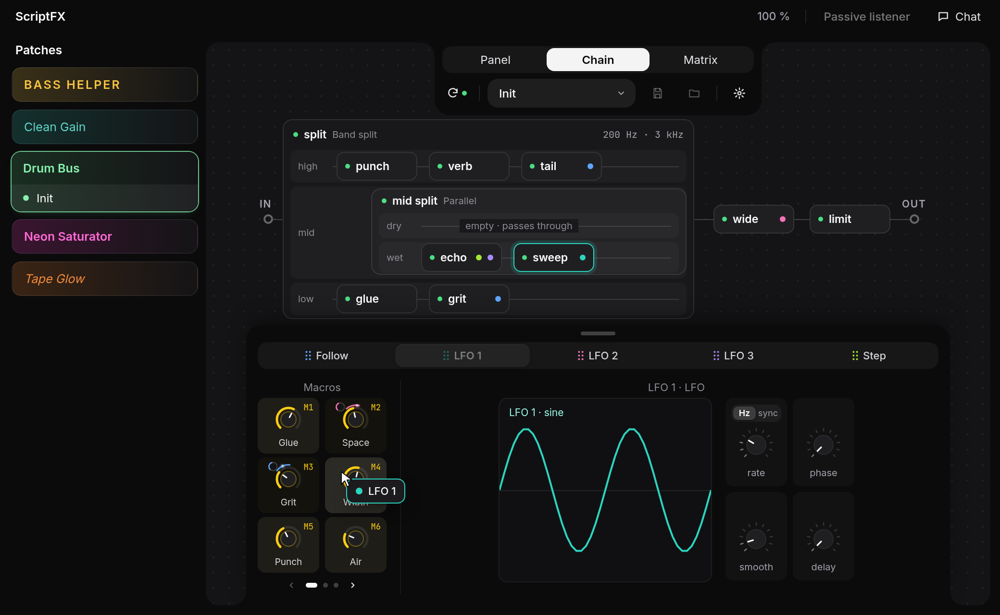
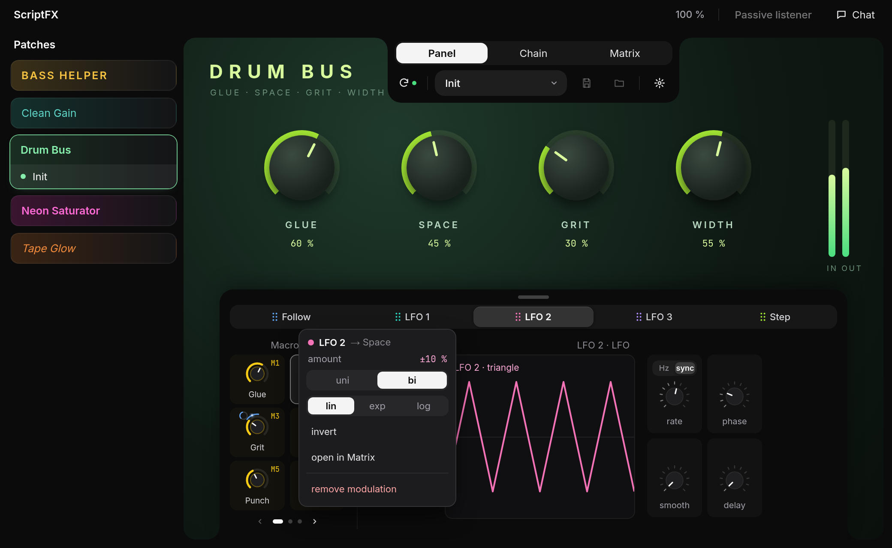
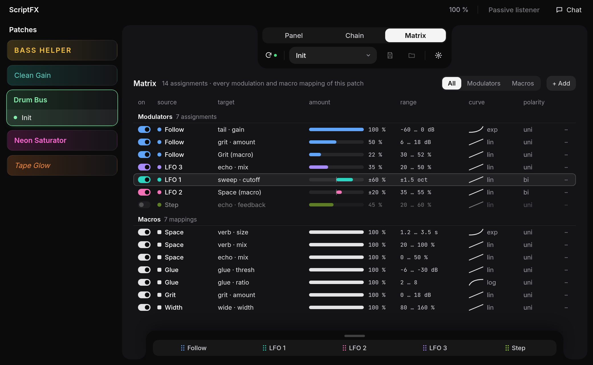
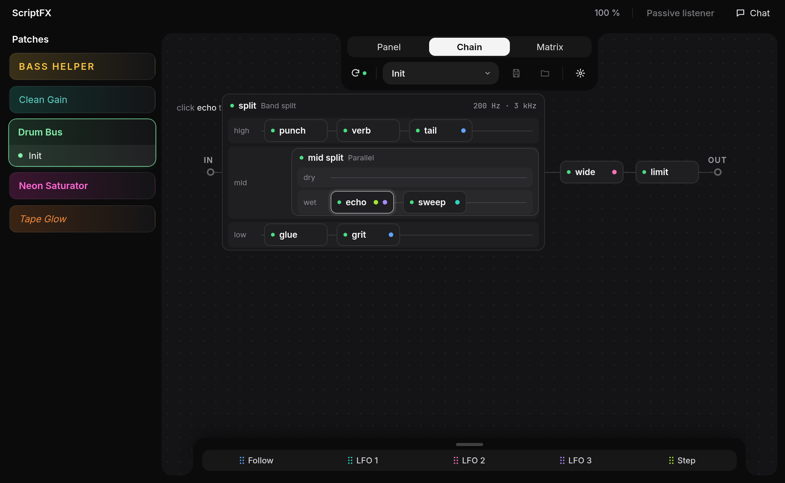
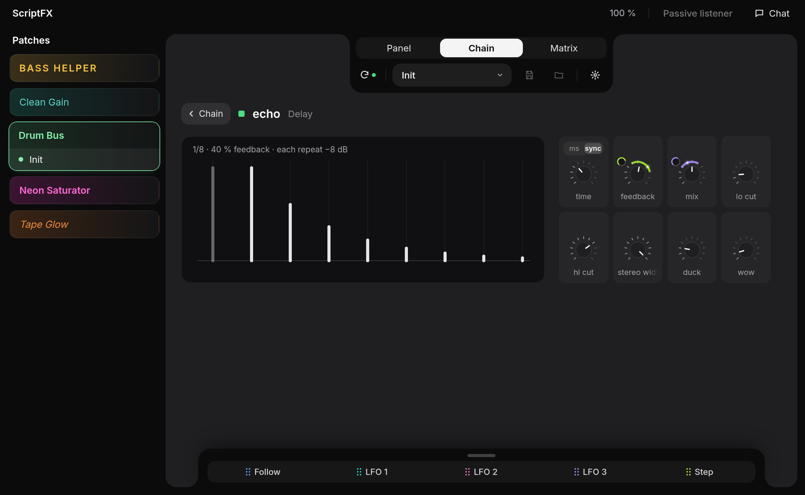
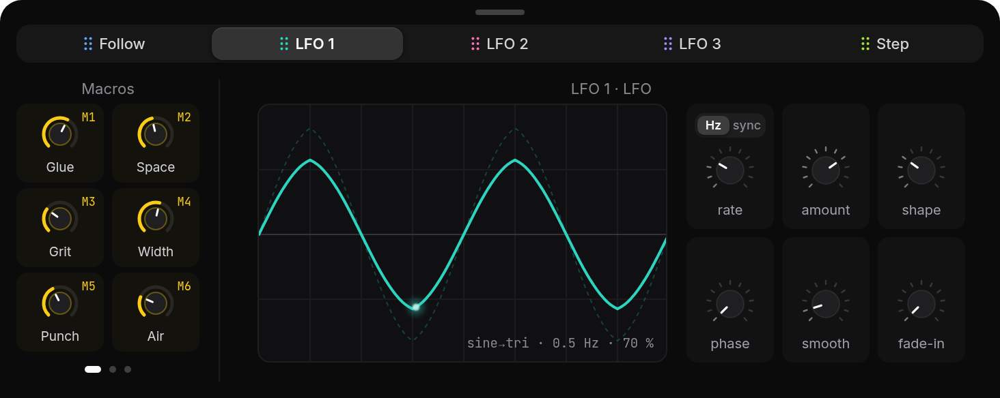
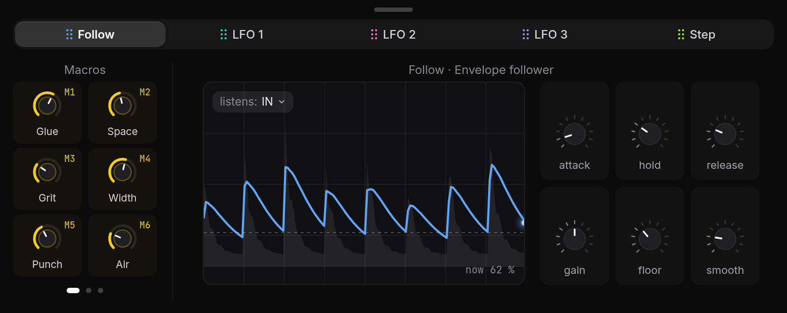
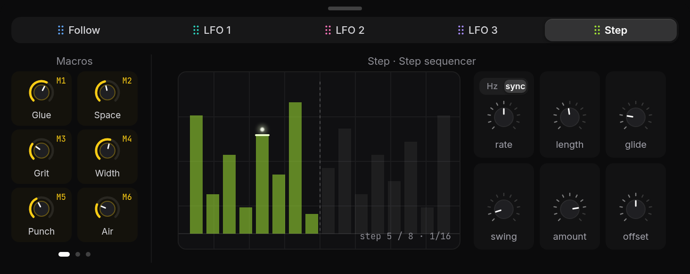

# Chain editor, drawer, modulation: concept

_2026-11-19. Worked out with Flemming in a long mockup session; the mockup is the claude.ai artifact
"ScriptFX Chain Editor Mockup" (artboards A–E, M1–M3). This doc is the reference for building it.
Related: [`../STATUS.md`](../STATUS.md) ("Open directions", decision "Patch kinds"),
[`patch-code-and-sharing.md`](patch-code-and-sharing.md)._

> **Status (2026-11-21).** Built on `main` (see [`../STATUS.md`](../STATUS.md)):
> the chain view (it now also snakes through rows), block pages with the zoom, the drawer's tab row,
> the knob cell, macro modulation. **Changed since this concept:**
> - The first view is **Surface** (was "Panel"): the ControlPanel, or the patch's macros as knobs.
> - **Macros moved out of the drawer** into the macro rail (left card from the top bar); the drawer
>   holds only the modulators. Both stay open while the page is used; drag a macro by the grip on
>   its "M3" tag, a modulator by the grip on its tab. Droppable knobs get an outline in the
>   source's colour (not a greyed tab as in B); a chip with the source follows the pointer.
> - **Drawer**: 180 px open (not ~300), so block pages keep their knobs above it. Panels: Follow =
>   scope + attack/release; LFO = shape pills (sine/tri/square) + scope + rate/phase; Step = bars
>   you draw on + rate. No amount on the modulator (amount is per route, as in Serum).
> - **Modulation follows Serum exactly** ([`serum-modulation.md`](serum-modulation.md)): any number
>   of slots per knob (not one source), amount −1…+1 (sign = direction, no invert), uni/bi (same range size), curve, bypass.
> - **Knob cell:** the range arc and the live dot sit on one ring outside the ticks; one **meta
>   knob per route** in its source's colour in the top line (not a single one at the top-left; up
>   to five, then "+N"); the cursor hides and the pointer stays locked while dragging.
> - **Matrix:** one row per route (macro slots and assignments), remove per row, an add row
>   (source → destination pick lists). No filtering yet.
> - Build order (§10): steps 1–5 done; glow/dots on targets and blocks, Matrix filtering and
>   step 6 remain open.

## 0. Screenshots of the mockup

Rendered from the artifact's artboards (2×) so the design survives without the artifact. Where the
text and a picture disagree, the text wins; known differences are noted.

**A · Chain view, nothing selected.** Two-row notch, chain as a tree (band split with slots, a
parallel inside the mid slot), the drawer with the five modulator tabs, macros (2×3, page 1/3) and
the open LFO. _The LFO panel here is the older one (4 knobs); the current LFO is M1._



**B · Dragging LFO 1 onto a macro.** The tab is carried (greyed in the row); droppable knobs (Glue,
Punch, Air) are a little lighter than their own background, the one under the pointer (Width) more.



**C · Panel view.** The patch's ControlPanel is untouched patch art; the drawer is the same as in the
chain view. Open: the right-click menu of Space's meta knob (LFO 2 → Space). _LFO panel: older
version, see M1._



**D · Matrix.** Every assignment: modulators (including macro targets) and macro mappings; the
drawer is collapsed to its tab row.



**E · Block page.** Before and after the zoom transition (click a block → it zooms in, 150 ms,
linear, radial blur; "‹ Chain" zooms back out). The page has the block node's colour.




**M1–M3 · The modulators** (drawer only): LFO with amount and shape, the envelope follower with its
"listens" chip, the step sequencer (length 8 of 16, step 5 playing).





## 1. Decisions in one list

| Topic | Decision | Rejected (and why) |
|---|---|---|
| Audio structure | **A tree**: blocks in series, containers (band split, parallel, mid/side, left/right) hold **slots** with child chains. Wiring is implicit. | A free graph with typed ports for everything: flexible but cable salad already at mid-size patches (mockup "free graph" round). A free graph may come back later as one *Grid* block. |
| Modulation | **Serum style**: a fixed set of modulators lives outside the chain; you connect one by dragging it onto a knob. One **list of assignments** per patch. | Modulators as blocks in the chain (needs a real graph to be useful); key-input pins (you can't see what the connection does). |
| Modulator set | **Fixed: Follow, LFO 1, LFO 2, LFO 3, Step.** | Env: parked (needs a gate, see STATUS backlog "DSP / chain"). Follow 2, LFO 4, Env 2: not needed. |
| One source per param | ~~Yes~~ **Replaced 2026-11-20 by Serum's model** ([`serum-modulation.md`](serum-modulation.md) is the source of truth): any number of slots per knob, each a normalized delta (amount −1…+1, uni/bi, curve tension, bypass) summed onto the knob's base, clamped, then the param's scale. One range arc shows (the focused slot), one meta knob per slot. | Plain-unit from/to mappings (deltas didn't add up across lin/log knobs). |
| Macros | Stay the **host layer** (16 slots, automatable, drive params). They **can be modulated**: the host sets the base value, modulation moves around it. | Macros "for humans only" without modulation. |
| Patch panels | The shell **never draws on patch art** (no rings, no outlines). Modulation lives in the drawer; **macros in the macro rail** (2026-11-20: left sidebar card from the top bar, so they can be tweaked over the panel too). | Rings via a `p.mod` component input: needs knowledge of every panel's geometry. |
| Block settings | A **page of their own**, reached from the chain with a zoom transition. | In the drawer (mixes two layers); a floating dialog (tried, dropped). |
| Assignments in detail | Their own view: **Matrix**. | Per-modulator target lists in the drawer (removed to free the space). |

## 2. Data model

```
Patch
├── chain        tree of blocks; containers have slots
├── params       block parameters (as today)
├── macros[16]   name, value 0..1, drives: [{ param, from, to, curve }]   (as today)
├── modulators   fixed set: follow, lfo1..3, step — each with its own settings
└── assignments  [{ source, target, amount, polarity, curve, invert, enabled }]
                   source = follow | lfo1..3 | step
                   target = param id | macro slot
```

- `amount` is bipolar or unipolar (`polarity`), `curve` lin/exp/log, `invert` flips it. These are
  per assignment, not per modulator. **(2026-11-20: now exactly Serum's slot, see
  [`serum-modulation.md`](serum-modulation.md): amount −1…+1 of the knob's travel (sign = invert),
  polarity, curve = tension −1…+1, bypass; deltas sum in normalized space before the param's
  scale. Built for macro slots.)**
- **Macro modulation**: `target = macro slot`; the effective macro value = host value + modulation,
  clamped, then mapped through the macro's `drives` as today. The host only ever sees the base.
- **Follow** needs an input: `listens = in | out | <block tap> | sidechain`. The default is the chain
  input.
- Modulation runs at control rate (per sub-block, like the graph already does for params), with
  smoothing against zipper noise. Modulators never allocate on the audio thread.
- Graph patches (STATUS: "Patch kinds") store exactly this as **data**; Luau patches produce the
  same structure from code (`Modulator.*`, `assign(...)`), so the shell, the Matrix and the LLM see
  one model. Format of the data file (Luau table vs. JSON) is still open.

## 3. Shell layout

```
┌ top bar ───────────────────────────────────────────────────────────┐
│ library │            ╭─ notch ─────────────────╮                  │
│         │            │ Panel │ Chain │ Matrix  │  view switch      │
│         │            │ ⟳• │ Init ▾ 💾 📂 │ ⚙   │                   │
│         │            ╰─────────────────────────╯                  │
│         │        patch window: Panel / Chain / Matrix / block page │
│         │     ╭─ drawer (rises from the bottom edge) ─────────╮    │
│         │     │ ─── handle                                     │    │
│         │     │ [Follow][LFO 1][LFO 2][LFO 3][Step]  full width │    │
│         │     │ Macros        │  LFO 1 · LFO                    │    │
│         │     │ 2×3 + pages   │  display │ 6 knobs (3×2)        │    │
│         │     ╰────────────────────────────────────────────────╯    │
└────────────────────────────────────────────────────────────────────┘
```

- **Notch**: two rows. Top: the view switch **Panel | Chain | Matrix** (now Surface | Chain | Matrix), full width. Below: reload
  (+ sync LED) | snapshot selector, save, load | settings. The signal line under the panel is gone
  (the chain view replaces it).
- **Drawer**: width `window width − 6 × window radius` (816 → 732 px), centred, concave flares at the
  bottom corners, Apple-style **handle** at the top. Same in every view; collapses to its tab row
  (Matrix view, block page).
  - **Tab row**: the five modulators, full width, equal widths. Each tab has a **6-dot grip in the
    modulator's colour** (draggable); the open one is raised. Unused modulators: faded grip.
  - ~~**Left column: Macros**~~ (2026-11-20: moved to the **macro rail**, a card on the left
    opened from the top bar; same 2×3 grid with pages, the page change slides).
  - **The open modulator**, title on top ("LFO 1 · LFO"), centred.
  - The drawer only ever shows modulators. Blocks never go in there.

## 4. Chain view

- Blocks are compact (name + small dots in the colours of the modulators that move them).
- **Containers are blocks with slots** (header "split · Band split · 200 Hz · 3 kHz", slots
  high/mid/low; a parallel inside the mid slot with dry/wet). No split/merge wires; containment says
  it. Only IN → … → OUT has wires.
- The open modulator's targets **glow** in its colour.
- **Clicking a block opens its page** with a **zoom transition**: the chain zooms into the block
  (to ~6×) and fades out while the block page grows out of the block (in the block's own colour,
  `#1f1f22`) and fades in. **150 ms, linear.** Radial (zoom) blur during the move; in iced this is a
  small post-process shader on the wgpu path (the mockup fakes it with trailing copies).
  "‹ Chain" plays it backwards.
- The **block page**: header (back, name, type), a large display of what the block does (e.g. the
  delay taps), and the block's knob cells.

## 5. The knob cell (one component for everything)

| Part | Spec |
|---|---|
| Cell | 64 × 92 px, radius 8, background white 3 % (macros: yellow 4 %), no border. |
| Top line (18 px) | The knob's **mode as a pill group** in tab style (`Hz \| sync`, `ms \| sync`); empty if none, so knobs in a row line up. |
| Knob (40 px) | **11 tick marks** around a flat disc (r 10) with a short white pointer; ticks up to the value brighter (45 % vs 16 %). No value arc. |
| Modulation | An arc **on the tick ring** in the source colour over the modulated range; a **glare spot** (tiny blurred white dot + coloured halo) at the current modulated value. |
| Meta knob | 12–14 px mini dial at the knob's top-left: ring + amount arc in the source colour. **Drag = amount, right-click = menu** (amount, uni/bi, lin/exp/log, invert, open in Matrix, remove). Built 2026-11-20 for macros: one dial per macro on the knob (up to 3 in the top line), settings saved per project; "remove" is "reset" for now (macro mappings come from the patch). |
| Label (14 px) | Centred under the knob. Too long → scrolls (mockup: fades out). **While dragging, the value replaces the label** (mono, white). |
| Macro variant | Cell 64 × 58 in the 2×3 macro grid; **32 px knob without ticks**: thick track + solid **yellow** value arc (`#facc15`), thin yellow rim on the disc; modulation arc just outside; **"M1"…"M16"** small, yellow, top right. |

**Drag & drop**: while a modulator tab is dragged, every knob it can land on gets **slightly lighter
than its own background** (a white overlay, dark in light mode); the one under the pointer a bit
more. Knobs that already have a source don't change. No outlines, no colours.

## 6. Modulators

All share one layout: **display (300 × 190, editable in place) + 6 knob cells (3 × 2)**. The only
non-knob control is a **chip** in the display's top-left for what the modulator listens to.

| Modulator | Display | Knobs |
|---|---|---|
| **LFO 1–3** | Two cycles of the wave, dashed full range (so *amount* is visible), glare spot as playhead | rate (`Hz \| sync`), **amount**, **shape** (continuous morph sine → triangle → saw → square), phase, smooth, fade-in |
| **Follow** | The input as a grey silhouette, the envelope as a line, a dashed floor; chip **"listens: IN ▾"** | attack, hold, release, gain, floor, smooth |
| **Step** | 16 bars, drawn directly; steps beyond *length* greyed with a dashed boundary; current step lit | rate (`Hz \| sync`), length, glide, swing, amount, offset |

Colours (fixed, never patch colours): Follow `#60a5fa`, LFO 1 `#2dd4bf`, LFO 2 `#f472b6`,
LFO 3 `#a78bfa`, Step `#a3e635`. Macros `#facc15`. (Amber was dropped for Step: too close to the
macro yellow.)

## 7. Panel view

The patch's ControlPanel stays untouched patch art. The drawer is the same as in the chain view:
macros on the left, the open modulator on the right. In the mockup the drawer covers the lower half
of the panel; the panel is 3:2 (816 × 544), so with the signal line gone there are 42 px below it,
exactly where a **collapsed** drawer fits without covering anything.

## 8. Matrix view

A table of every assignment, in two sections:
- **Modulators** (source → target, including targets that are macros): on/off switch in the source
  colour, source, target, **amount** (bar, bipolar from the centre), range, curve (+ mini graph),
  uni/bi, `⋯` for more.
- **Macros** (macro → param mappings): the same columns.

Filter (All / Modulators / Macros) and "+ Add" on top; the drawer is collapsed here.

## 9. Open

- **More input types** for block/modulator params (switches like bypass/ping-pong, choices like
  filter type, maybe steppers); until then knobs + pill groups only. Backlog in STATUS ("Shell / UI").
- The **chips** (listens to …) are the first non-knob input; design them with the above.
- **LFO offset / own polarity** (today polarity is per assignment only).
- **Envelope**: parked; needs a gate (transient trigger + level or time gate). STATUS backlog ("DSP / chain").
- **Block page content** per block type (which blocks get which display).
- **Light mode** for all of this (the shell already has System/Light/Dark).
- Drawer **collapse rules** (when does it collapse by itself, does the panel view start collapsed?).
- Many sources per param, if one turns out to be too few.
- Data file format for graph patches (Luau table vs. JSON).

## 10. Build order (proposal)

1. **Model**: modulators + assignments in the `patch` crate (Luau API + data), macro modulation,
   validation (one source per param, targets exist).
2. **DSP**: modulator engine in `dsp` (Follow with its input tap, LFO with shape morph, Step), applied
   per sub-block with smoothing; no allocation on the audio thread.
3. **Shell, drawer**: tab row, macro grid + pages, the knob cell as one iced widget (tick knob,
   modulation arc, glare, meta knob, pill group), drag & drop of modulator tabs, the context menu.
4. **Chain view**: tree layout with container cards, block → page navigation, zoom transition
   (shader).
5. **Matrix view**.
6. Panel view drawer behaviour (collapse rules).
