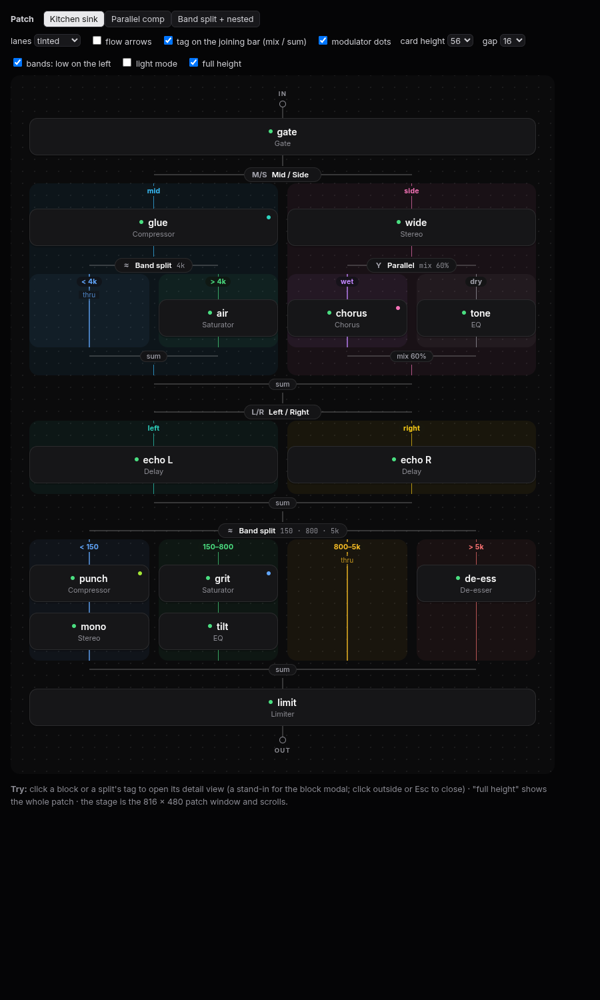

# Chain view layout: alternatives explored

_2026-11-25. Sketch session with Flemming. Status: **contender, not adopted.** The current chain view
(horizontal snake, containers as cards with slots: [`chain-editor.md`](chain-editor.md) §4,
`shell/chain_view.rs`) stays; none of the alternatives below was judged more user-friendly than it._

## Starting point

- The chain is rigid: no reordering or adding blocks. A node-graph editor (Unreal, TouchDesigner,
  Material Maker) was considered for editing.
- **Kept: the tree** (blocks in series, splits with lanes). Pedal modelers (Quad Cortex, Headrush,
  Helix), Guitar Rig, Ableton racks and Bitwig containers all use series-parallel structures; free
  graphs (Axe-Fx grid, Reaktor) are the hardest to read. A free graph may come back as one Grid block.
- **Editing without wires** (not built, not mocked): every gesture is one tree operation, wires are
  drawn, never made. Drop on the line = insert; drag = move (Alt = copy); drop below a block = wrap it
  in a parallel; drop below a gap = parallel with a dry lane; a split with one lane left unwraps.
  Splits map onto pedal split types: Parallel = Y, BandSplit = crossover, MidSide / LeftRight.
- **Simple vs. professional:** one simple UI over the full model, no "pro mode". What reads as
  amateur is hitting limits, not having few buttons.

## Sketches (all in `mockups/`, open in a browser)

| File | Idea | Verdict |
|---|---|---|
| [`chain-metro.html`](mockups/chain-metro.html) | Horizontal "metro map": blocks on the line, a split is a fork glyph (Y / ≈ / M/S / L/R), lanes are coloured wires, merge dot; band lanes ordered like a spectrum, crossovers draggable in the gap. Four ways to handle chains wider than the stage: scale, wrap rows with ①② connectors, auto-collapse into stacks, zoom into a split with a breadcrumb | Messy; wide chains get small or need collapsing/zooming |
| [`chain-rack.html`](mockups/chain-rack.html) | Vertical rack (Guitar Rig-like): big full-width cards, centred titles, no controls; a split divides the width into columns. Three split styles: prism (pill fans out into lanes), divider, tab row | Divider style liked in principle |
| [`chain-rack-styled.html`](mockups/chain-rack-styled.html) | The divider rack in the shell's design (theme tokens, Inter, dot grid, LEDs, modulator dots): a split is a **bus bar** with a pill, each lane drops its own coloured wire, a second bus bar joins them (tag only where it carries info: mix). Clicking a block or a split opens its detail view (stand-in for the block modal; band split sketched as a spectrum) | **Contender**; not clearly friendlier than the current view |

## What was learned

- **Splits as their own element** (bus bar, not a card) are what make the rack readable; nested
  cards/boxes were the main complaint about the current look.
- **A split opens a detail view, it doesn't collapse.** Same pattern as blocks.
- **Band splits want a spectrum** (low → high, lowest band always the same colour) both in the lane
  order and in the split's detail view.
- **No controls on cards.** The block modal is the place for them.
- **Height is the rack's cost:** the kitchen sink is ~1000 px at 56 px cards vs. a 480 px stage, so
  it scrolls. The metro's cost is width (wrapping, scaling below ~80 % is unreadable).
- Wrapping a horizontal chain must not mirror splits (the current boustrophedon snake would run
  forks backwards on every other row); rows should read left to right and break only between
  top-level nodes.

## Open

- What would make a layout clearly friendlier than the current one: probably editing (insert gap,
  drag & drop, drop-below → split) more than the static picture. Mock the gestures next, on the
  current view.
