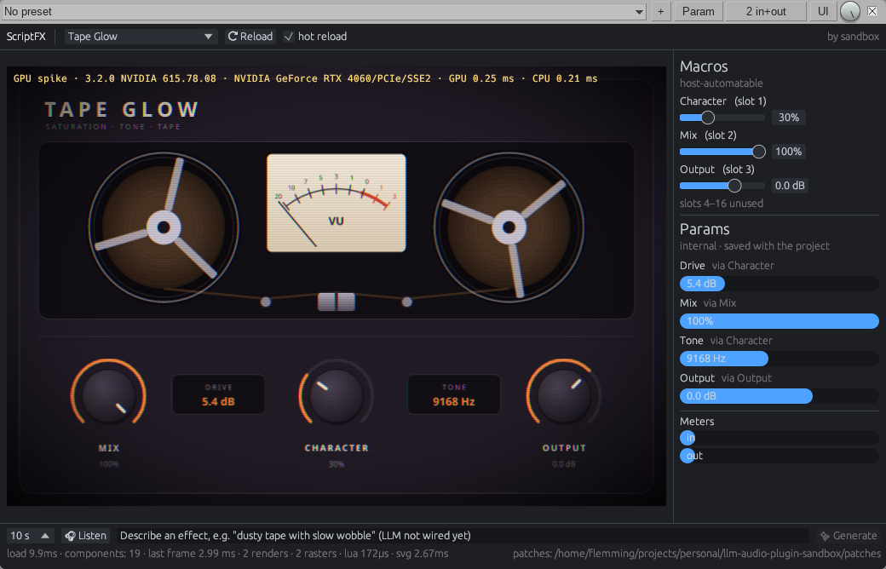
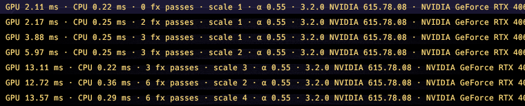
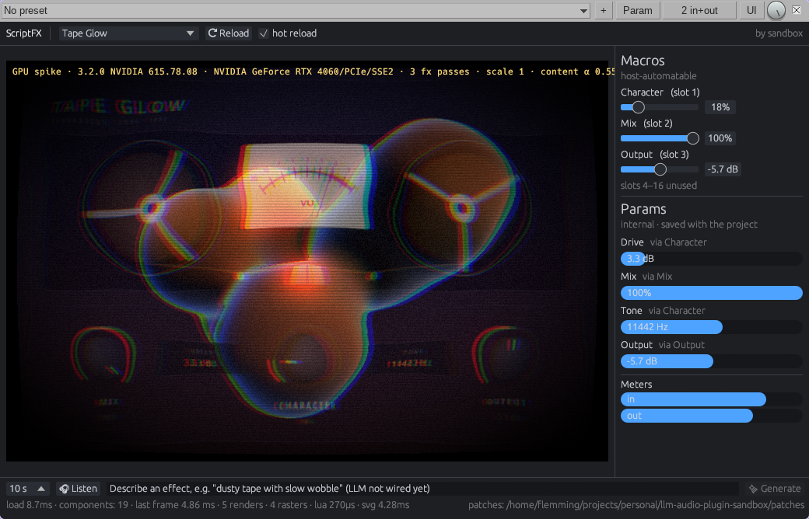
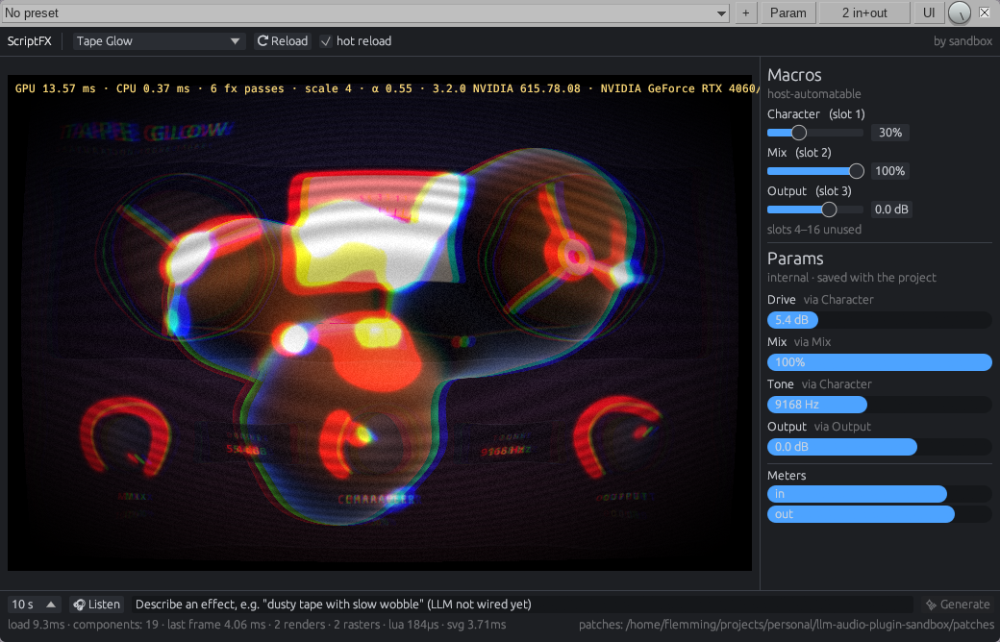
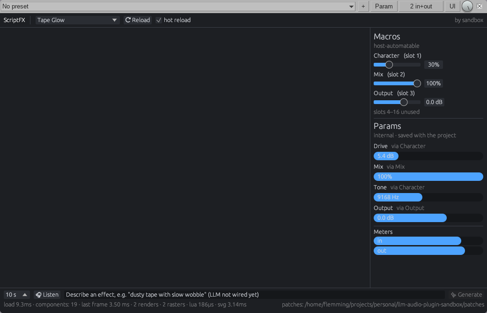
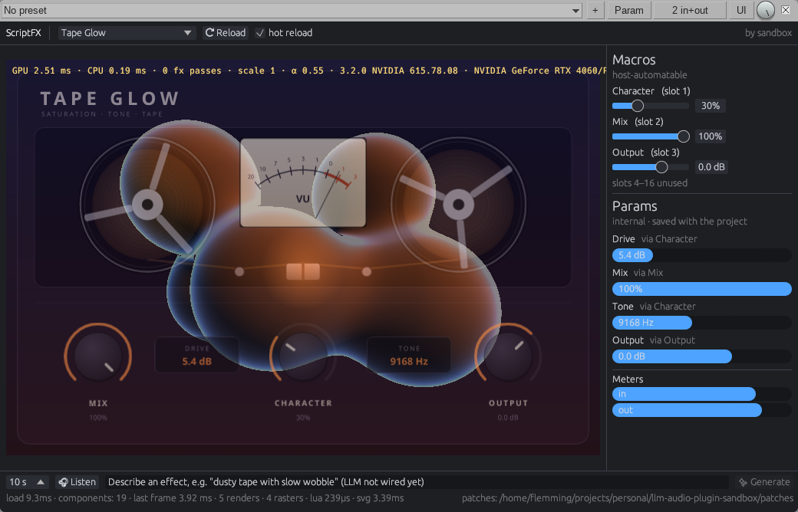

# UI plan: raster layers, sprite sheets, shaders

_Decided 2026-11-18 (Flemming). Background: [`kontakt-ui.md`](kontakt-ui.md),
[`patch-code-and-sharing.md`](patch-code-and-sharing.md)._

> **Status (2026-11-20, Flemming):** decision 1 was reversed. The reactive component UI was parked,
> then revised, and is the patch UI again: **still the plan**. The rest of this doc (raster layers,
> sprite sheets, shader layers, the effects toggle) stays as open ideas for it; the GPU spike notes
> below predate the iced shell (egui was replaced, see [`shell-ui-toolkit.md`](shell-ui-toolkit.md)).

## Decisions

1. **The reactive component UI is scrapped** until there's a solid plan for it. The current
   `ui-components` engine stays in place only until the replacement renders the factory patches.
   Keep **Slint** in mind for that plan: declarative and reactive, with layouts; `slint-interpreter`
   loads `.slint` files at runtime (no build step); no file or network access in the language; its
   software renderer could draw a UI into one of our layers. Check the license first (GPLv3 /
   royalty-free / commercial).
2. **Raster runtime, SVG and PNG sources.** Artwork is PNG or SVG; SVG is rasterised at load (and
   again when the scale changes). Bitmaps may come with an `@2x` variant.
3. **Sprite sheets are "2D filmstrips":** the frames of *one* element laid out in `rows × columns`,
   read left to right, top to bottom. A classic filmstrip is the case `columns = 1` (or `rows = 1`).
   The grid avoids GPU texture size limits for long strips (e.g. 128 frames × 200 px @2x). No atlases
   with different images.
4. **Layers, rendered back to front.** A patch declares an ordered list of named layers:
   - **content layer:** images, controls, text; optional **effect** shader that only sees this
     layer's pixels;
   - **generated layer:** a shader with no input (e.g. an animated background);
   - **adjustment layer:** no content; its shader sees the composite of everything below it.

   Controls say which layer they're on (`layer = "knobs"`). Every shader gets the same inputs: time,
   level, a small spectrum texture, meter values, macro values, layer size. A later component system
   can let each component name its layer.
5. **Effects toggle:** a shell setting turns shaders, effects and animations off. Fallback: layers
   without effects, static frames, generated layers as a still or plain colour.

## Rules and limits

- **Clicks** follow the logical control positions. A shader that warps a control layer moves pixels,
  not hit areas: allowed, and the author's responsibility.
- **At most ~8 layers per patch.** Static layers are cached; layers that animate (or feed an animated
  shader) redraw per frame.
- **Shaders are WGSL fragment shaders,** validated by naga (also translated to GLSL for the OpenGL
  backend). Only the documented inputs; no other textures or buffers.

## First step: spike the GPU compositing path

Today the panel renders on the CPU (resvg / tiny-skia) and uploads textures to egui. Shaders need a
GPU path:
- egui's OpenGL backend (glow) with custom paint callbacks;
- offscreen textures per layer;
- naga WGSL → GLSL.

Go if: it works inside Reaper and Carla on Linux (and on Windows), costs < 1 ms per frame for 4 layers
at 840×560 @2x, and a runaway shader can't freeze the editor for more than a second.

Then: the sprite-sheet control model (knob, slider, switch, meter, label) with the layer list, then
port the factory patches, then remove `ui-components`.

## Spike results (2026-11-18, Linux)

Code: `crates/plugin/src/gpu_spike.rs`, enabled with `SCRIPTFX_GPU_SPIKE=1` (otherwise inactive). It
takes the existing CPU-rendered panel layers and composites them on the GPU, with patch-style WGSL
shaders (validated and translated to GLSL 330 by naga 30): a **generated layer** (animated plasma,
pulses with the output level) under them and an **adjustment layer** (chromatic split, vignette,
scanlines, audio-reactive) over everything. GPU time is measured with timer queries.

| Where | GL context | Result |
|---|---|---|
| Standalone, Mesa llvmpipe (software; needed for the standalone on this NVIDIA box) | 4.6 core | works; timings meaningless (software) |
| **Reaper 7.84, VST3, NVIDIA RTX 4060, driver 615.78** | **3.2 core** | **works: 19 layers + 3 passes ≈ 0.25 ms GPU, 0.21 ms CPU per frame** (panel ≈ 760×515 px) |

Findings:
- egui_glow paint callbacks are a workable integration point: our own framebuffer, textures and
  programs inside the egui frame. egui restores its state afterwards except the framebuffer binding
  and scissor, which the callback handles itself.
- naga output is predictable: one uniform block (`Inputs_block_0Fragment`, bound to UBO slot 0),
  combined samplers named after their binding, varyings `_vs2fs_locationN` matching our
  hand-written vertex shader.
- **GLSL version:** baseview asks for a 3.2 core context. NVIDIA accepted `#version 330` anyway, but
  strictly 3.2 means GLSL 150. Before production: request 3.3 in the vendored `nih_plug_egui`, or
  have naga emit `Desktop(150)`.
- Texture orientation: offscreen passes render flipped, so every texture (uploaded or rendered) has
  its top row at t = 0 and patch shaders always see uv (0,0) top-left.

Not tested yet:
- ~~Runaway shader~~: tested later the same day, see below.
- Carla (VST3) and Windows/macOS hosts; HiDPI scale 2× (4× the pixels; expected well under 1 ms).
- Larger layer counts with real per-layer effects (only the generated and adjustment passes exist).

**Verdict: go.** The compositing path works in a real host on Linux with a large margin. Next:
the layer list + sprite-sheet controls for real, the loop check, then the other platforms.

## Visual stress test (2026-11-18, Reaper, RTX 4060)

The spike can load shaders from a folder (`SCRIPTFX_GPU_SPIKE=<dir>` with `bg.wgsl`, `fx*.wgsl` as
adjustment passes in name order, `config.txt` with `scale` and `content_alpha`), hot-reloaded.
Test shaders: a raymarched background (6 blended spheres, up to 128 steps per pixel, audio-reactive),
a ripple warp with a chromatic split, an over-the-top bloom (25×25 = 625 texture reads per pixel), and
CRT curvature/scanlines/grain/vignette. Panel at 55 % opacity over the background, Tape Glow, a tone
generator feeding the level. Panel ≈ 760×515 px at scale 1.

| Load | GPU per frame |
|---|---|
| raymarched background only, scale 1 | 2.1 ms |
| + warp + CRT (2 passes), scale 1 | 2.2 ms |
| + 625-tap bloom (3 passes), scale 1 | 3.9 ms |
| 3 passes, scale 2 (HiDPI) | 6.0 ms |
| 3 passes, scale 3 | 13.1 ms |
| 6 passes (4 blooms), scale 2 | 12.7 ms |
| 6 passes, scale 4 | **GPU at 100 %**; timer readings stale (≥ 13.6 ms, real value higher) |

CPU stays at 0.2–0.4 ms per frame throughout; the cost is all on the GPU.

Takeaways:
- What's possible: raymarched 3D backgrounds, bloom, warps and CRT looks, all audio-reactive, at a
  few ms per frame at normal and HiDPI scale. The visuals are far beyond what SVG layers could do.
- The limit is fill rate: the cost scales with pixels × passes × texture reads. A real bloom would be
  separable and downsampled (a few % of the 625-tap version); the brute-force one here is a stress
  test, not a technique to ship.
- Needed for production: a **per-patch GPU budget** (measured per frame; drop to the effects-off
  fallback when exceeded), a cap on passes and render scale, and the timer must not trust stale
  queries (use a query ring, or fall back to frame rate).
- A warp/CRT pass over the controls bends them visibly while clicks stay at the logical positions:
  allowed by the plan, but authors should keep warps out of control layers.

## Runaway shader test (2026-11-18, Reaper, RTX 4060, driver 615.78)

A fragment shader with an endless loop (`loop { … if (u.time < -1.0) { break; } }`) was added as an
adjustment pass while Reaper was running. naga accepts it: whether a loop terminates can't be
decided in general.

What happened:
- **The desktop stayed responsive** (compositor, screenshots, other apps); GPU load stayed at 4–9 %.
- The NVIDIA driver's watchdog killed the hung GPU work every ~10 s: kernel log
  `NVRM: Xid 109 … CTX SWITCH TIMEOUT` for the process `reaper_host_x86` (Reaper runs the plugin in
  a separate host process here).
- **The plugin kept working:** audio and meters running, sidebar and footer drawn; only the panel
  area stayed empty.
- 
- **Full recovery without a restart:** after deleting the shader, hot reload compiled the remaining
  shaders and the panel rendered normally again (2.5 ms GPU).

  

Takeaways:
- On this setup a runaway shader costs the panel's rendering, not the system. That's the driver's
  watchdog, though, not our design: other drivers and OSes (Windows TDR resets the whole GPU after
  2 s; macOS; Mesa) behave differently and must be tested.
- Still do the cheap defences: reject loops without a constant bound at validation (or inject an
  iteration cap), detect a pass that doesn't finish (fence with a timeout) and switch that patch to
  the effects-off fallback with an error message, instead of retrying the shader every frame.
