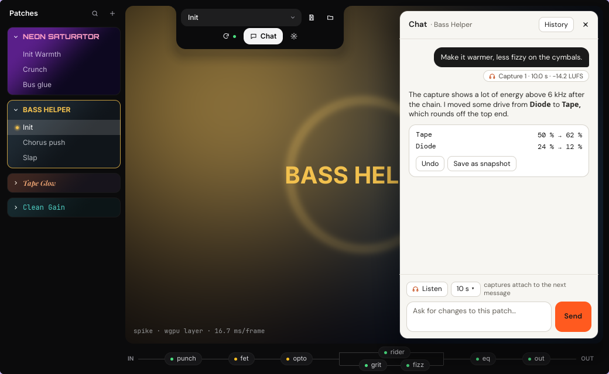
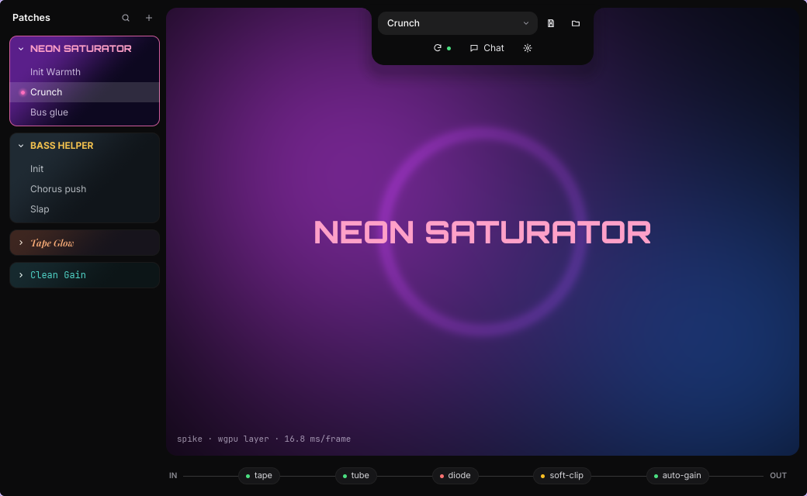
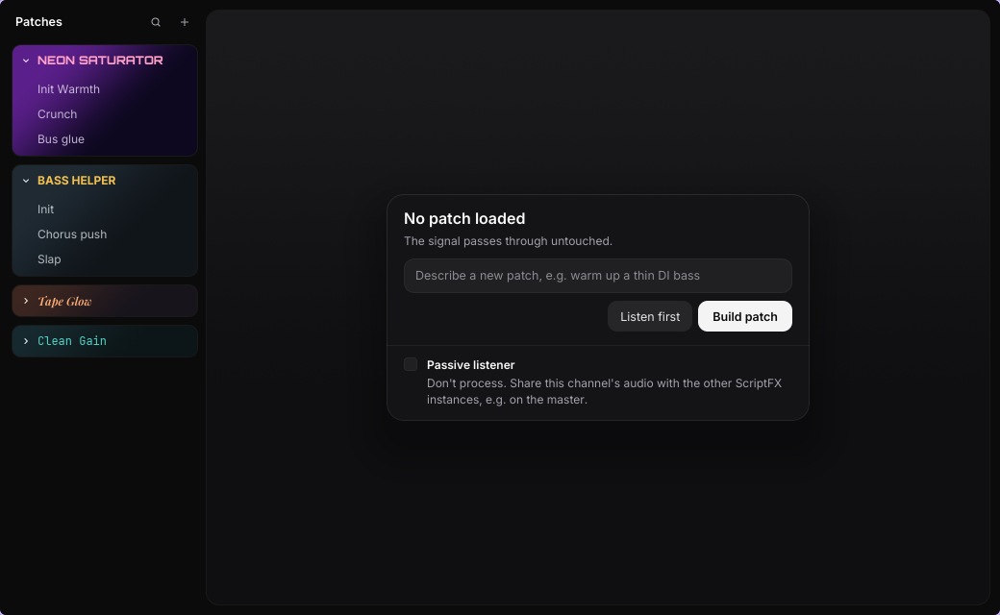
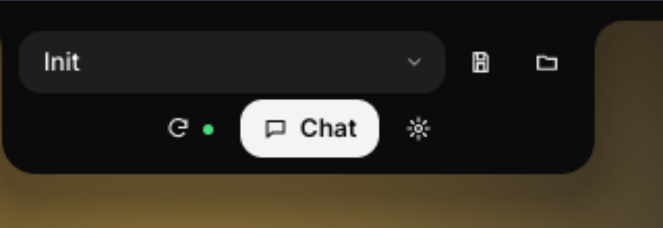
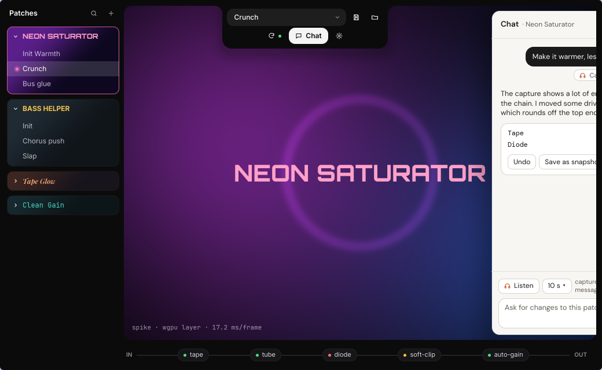
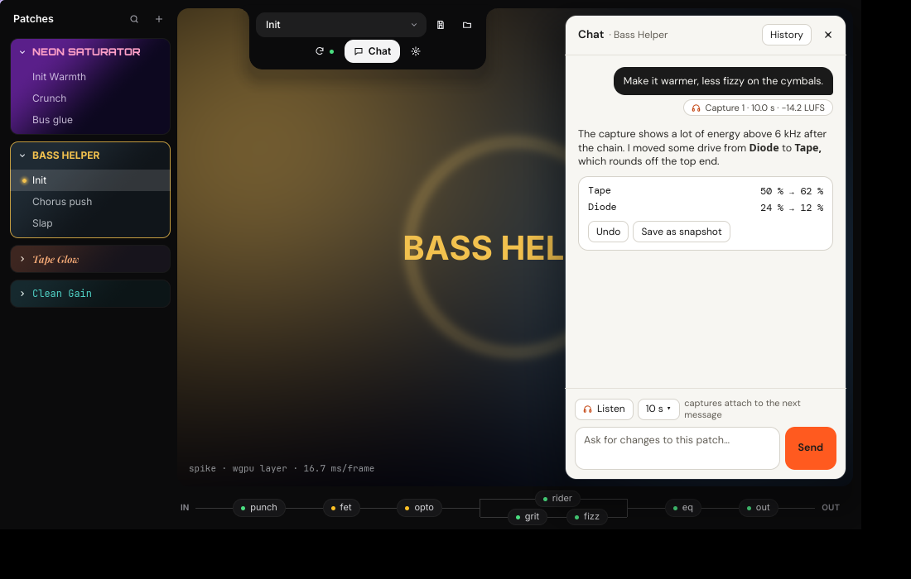

# Shell UI reboot: toolkit assessment, research, plan

_2026-11-18. Question (Flemming): rebuild the shell UI with GPUI or one of the other contenders?
Status: **decided: iced, spike done, built into the plugin** (2026-11-18; see STATUS "Where we left off").
Later findings there supersede the frame-pacing notes below: vsync stays off in plugins; baseview's
frame timer + a slow iced_baseview poll timer fix it (`vendor/baseview/PATCHES.md`).
Flemming's goal: UI code that is clean, easy to understand, split into components or sections, and
stays maintainable while we tinker. How the toolkit works inside doesn't matter._ Related: [`raster-ui-plan.md`](raster-ui-plan.md)
(GPU layers + WGSL shaders), STATUS "Shell layout" (v7 mockup)._

## 1. Assessment: what we have, what the shell must do

**Today.** `crates/plugin/src/shell.rs` (700 lines) is the egui PoC chrome: header combo box,
macro/param sidebar, prompt footer, listen overlay, and the component panel as egui textures.
`gpu_spike.rs` (600 lines) composites patch layers with WGSL shaders translated to GLSL by naga,
inside egui_glow paint callbacks. All of it runs on `nih_plug_egui` → `egui-baseview` (OpenGL) →
our vendored `baseview` (patched so GLX errors don't panic).

**Known pain points of the current stack:**
- **OpenGL on Linux/NVIDIA:** GLX errors on close/reopen (patched around), the standalone crashes
  when tiled (needs Mesa llvmpipe), baseview gives a 3.2 core context (GLSL 150 vs. the 330 naga
  emits). On macOS, OpenGL is deprecated.
- **WGSL → GLSL translation** adds a step, a second shader dialect to debug, and naga GLSL quirks.
- **Looks:** egui can be styled but fights the dense, bevelled "native" look from the v7 mockups.
  Layout is immediate mode (no flexbox/grid). Text rendering is adequate, not great.
- **nih-plug is in maintenance mode.** The community fork is now its own project, **nice-plug**
  (0.4.2, Sep 2026, on crates.io), with maintained adapters: `nice-plug-egui` 0.6 (egui 0.37,
  OpenGL *or* wgpu) and `nice-plug-iced` 0.5 (iced 0.14, wgpu), all on a published `baseview`
  0.4. We're on a vendored nih-plug at `de421011` with our own patches.

**Requirements for the new shell** (from the v7 layout and the raster UI plan):

| # | Requirement | Weight |
|---|---|---|
| R0 | **Code structure:** sections/components with clear boundaries; state changes traceable; doesn't degrade into spaghetti as the shell grows | must |
| R1 | Embeds in the host's window (X11 child / HWND / NSView), several instances per process, host-driven resize, HiDPI | must |
| R2 | Hosts the **patch compositor** in the same window: our own GPU passes (layers, WGSL shaders, timer queries) | must |
| R3 | **Chat drawer:** multi-line input, selection, clipboard, IME, scrolling message list with markdown and code | must |
| R4 | Dense, bevelled, "native-looking" shell style; flexible layout | high |
| R5 | Robust on NVIDIA/Linux, Windows, macOS (Metal) | high |
| R6 | Maintained, works with our plugin framework, Rust | high |

The shell and the patch UIs are separate concerns: the shell toolkit never draws a ControlPanel,
and the patch UI model (raster layers, sprite sheets, shaders) doesn't depend on it. The only link
is technical (R2): the plugin gets **one** window from the host with one GPU context. The shell
toolkit owns it, so the ControlPanel compositor has to render inside the toolkit's frame through a
custom-render hook. Any toolkit with such a hook works. One on **wgpu** also lets the patch shaders
run as WGSL directly instead of being translated to GLSL.

Earlier shortlist (STATUS, before this doc): **Slint** and **vizia** as contenders, GPUI ruled out.
This doc rechecks those three against the current state of the ecosystem and adds iced and egui on wgpu.

## 2. Research: the contenders

### GPUI (Zed): not viable for a plugin
- **No embedding.** GPUI creates and owns its top-level windows. A PR adding `WindowKind::Child`
  with a raw parent handle (Windows only) was **closed unmerged** in Feb 2025: maintainers want a
  cross-platform design first, and none has landed since
  ([zed#24330](https://github.com/zed-industries/zed/pull/24330)). What did land goes the other way:
  exposing GPUI's own handle so *others* (wry, CEF) can embed into GPUI
  ([zed#24327](https://github.com/zed-industries/zed/pull/24327)). A macOS-only "hosted window"
  experiment exists in a personal fork. **No plugin project uses GPUI**; no baseview backend exists.
- **Owns the app.** `Application::run` takes over the main thread's event loop. A plugin lives in
  the host's process and event loop, often with several instances. We would have to fork GPUI's
  platform layer on all three OSes (X11 child window, `WS_CHILD` HWND, NSView in a host view) and
  drive it from host callbacks. That's the hardest part of any plugin UI, and we'd maintain it alone
  against an API that changes with every Zed release.
- **No user GPU passes.** GPUI draws only its own primitives (Metal on macOS, DirectX on Windows,
  Vulkan via Blade on Linux). There's no paint-callback hook for our compositor (R2).
- What it would give: excellent text, smooth rendering, flexbox layout, `gpui-component` widgets
  (0.5, Feb 2026). The *look* comes from design, not from the library. We can get it elsewhere.

### Slint: good language, immature plugin bridge
- `slint-baseview` 0.1.0 (June 2026, 56 downloads) and `nice-plug-slint` (**WIP**, git dependency).
  Developed and tested on **Windows only**; macOS/Linux "want testing". Built on **baseview 0.1**
  while the rest of the nice-plug ecosystem is on 0.4. Renders with FemtoVG (**OpenGL**), so it
  keeps every GL problem we have.
- Custom GPU: `set_rendering_notifier` (GL underlay/overlay) or importing wgpu textures (needs the
  wgpu renderer, which the baseview bridge doesn't use).
- Strengths: declarative `.slint` with real layouts. License: GPLv3 / royalty-free / commercial;
  we're GPLv3 already through `vst3-sys`.
- Changed since the earlier shortlist: the adapter turned out to be WIP and OpenGL-only.

### iced: best fit on paper
- `iced_baseview` 0.6 (Oct 2026, iced 0.14, baseview 0.4) and `nice-plug-iced` 0.5 are maintained
  as part of nice-plug.
- Renders with **wgpu** (Vulkan / Metal / DX12; no GLX), with tiny-skia as a CPU fallback.
- The `shader` widget runs **our own wgpu pipelines in WGSL** inside the UI tree (R2), with no
  translation step.
- Has the chat pieces: `text_editor` (multi-line, selection, clipboard), a **`markdown`** widget
  and a syntax **`highlighter`** (feature flags on `nice-plug-iced`). IME support depends on what
  baseview forwards; to be tested.
- Elm architecture (state → view → messages) suits a shell with clear state (patch list,
  snapshots, chat, settings). Styling is per-widget style functions: custom bevels are doable.
- Caveats: iced moves slowly and breaks its API between minor versions. Per-frame cost is higher
  than egui for big, changing UIs; ours is small. Text editing is younger than egui's.

### egui + wgpu: the cheap upgrade
- `nice-plug-egui` 0.6 → `egui-baseview` 0.9 with a **`wgpu` feature**. egui-wgpu has paint
  callbacks (`CallbackTrait`), so the compositor runs WGSL natively.
- Keeps the 700 lines of shell code and the knowledge we have. Fixes R2 and R5 without a rewrite.
- Doesn't fix R4: immediate-mode layout, limited styling, average text.

### Others (ruled out)
- **vizia** (on the earlier shortlist): no longer an official nih-plug bridge. Now `vizia-plug`,
  third party, needs nightly Rust. Skia renderer, fixed-size windows recommended, no clean path for
  our own GPU passes.
- **WebView (wry):** `nih-plug-webview` is macOS/Windows only (last push Jan 2025); Linux needs
  WebKitGTK and an X11-only embed. Heavy, and a second runtime for shaders.
- **Xilem/Masonry** (`xilem_baseview` exists): experimental, unstable API.
- **truce** (a new plugin framework with egui/iced/Slint/vizia backends, AU/AAX too): interesting
  if we ever leave nih-plug for formats; not needed now.

### Scorecard

| | R1 embed | R2 own GPU passes | R3 chat text | R4 look/layout | R5 robust (no GL) | R6 maintained |
|---|---|---|---|---|---|---|
| GPUI | ✗ (fork 3 platform layers) | ✗ | ✓✓ | ✓✓ | ✓ | ✗ (for plugins) |
| Slint | ~ (WIP, Windows-tested) | ~ (GL underlay) | ~ | ✓✓ | ✗ (FemtoVG GL) | ~ |
| vizia | ✓ | ✗ | ~ | ✓ | ~ (Skia) | ~ (third party, nightly) |
| **iced** | ✓ | ✓✓ (WGSL `shader` widget) | ✓ (`text_editor`, `markdown`) | ✓ | ✓ (wgpu) | ✓ |
| egui + wgpu | ✓ | ✓✓ (paint callbacks) | ✓ | ~ | ✓ (wgpu) | ✓ |
| egui + GL (today) | ✓ | ✓ (GLSL via naga) | ✓ | ~ | ✗ | ✓ |

## 3. Recommendation

1. **Not GPUI.** Using it would mean building the plugin embedding for it ourselves, on three OSes,
   against an unstable API. It still wouldn't host our shader compositor.
2. **Move the GPU stack to wgpu.** This matters more than the widget toolkit choice: WGSL runs
   natively (no naga → GLSL step), no GLX problems on NVIDIA, Metal on macOS. Both serious options
   (iced, egui) render on wgpu.
3. **Rewrite the shell in iced** (decided). For R0, iced's Elm architecture is the main reason:
   - every shell section is a module with its own state, `Message` enum, `update` and `view`
     (`library`, `pill`, `stage`, `chat`, `settings`);
   - the top-level app only routes messages;
   - all state changes go through `update`, and `view` is a pure function of the state.

   egui mixes state changes into drawing code, which is what degrades as the shell grows. Slint has
   the most component-like code (markup files), but its plugin bridge is WIP, Windows-tested and
   OpenGL-only: we'd be debugging the bridge instead of building the shell. Since the shell gets
   redesigned anyway (v7), a rewrite costs little more than a restyle.
   - Fallback if the spike fails a must: Slint.
   - If both fail: keep egui, move it to wgpu and restructure it into section modules.
4. **Migrate nih-plug → nice-plug first.** Both adapters target nice-plug + baseview 0.4. Our two
   local patches have to be ported or upstreamed: runtime parameter names
   (`kParamTitlesChanged` / `RESCAN_INFO`) and baseview GLX panics. The GLX one disappears with
   wgpu (no GL context).
5. **Patch UIs are not part of this decision.** The raster layer plan stands as is; the shell only
   provides the window area and the render hook the compositor draws in.

## 4. Plan

**Step 0: spike (1–2 days, throwaway, confirms iced).**
A minimal v7 shell in `nice-plug-iced` as a separate example plugin:
- patch list on the left, two-row pill, chat drawer with `text_editor` + one `markdown` message;
- one `shader` widget running a WGSL generated layer + adjustment layer (port two shaders from
  `gpu_spike`), with GPU timing;
- **Go criteria**, in Reaper and Carla (VST3) on the NVIDIA box:
  - close/reopen ×10 and host resize work;
  - two instances open at once;
  - typing, selection and copy/paste work in the drawer (dead keys / IME at least on X11);
  - HiDPI scale 2;
  - frame cost ≤ 1 ms CPU at idle, ≤ the egui spike for the same shaders on GPU.
- Then the same check on Windows (Fender Studio). macOS when CI runs.
- Also judge the code: the spike already uses one module per section. Check whether adding a
  feature (e.g. a settings toggle that affects the stage) stays local.
- If iced fails a must, try the same spike with `slint-baseview`.

**Step 1: framework migration.** Move `vendor/nih-plug` → `nice-plug` 0.4 (crates.io, or vendored
again if our patches aren't accepted). Port the parameter-name patch, test host renames in Reaper.
Drop the baseview GLX patch once nothing uses GL.

**Step 2: compositor on wgpu.** Port `gpu_spike` to a toolkit-independent `compositor` module:
wgpu device from the toolkit, offscreen texture per layer, WGSL validated by naga (no GLSL), timestamp
queries in a ring, per-patch GPU budget, the effects-off fallback, the loop check. It renders the
current CPU-rasterised component layers until the sprite-sheet model replaces them.

**Step 3: v7 shell in iced.** Patch/snapshot list, ControlPanel stage (compositor), two-row pill,
signal line, chat drawer (no LLM yet), settings incl. "Effects off", empty default state
("No patch loaded"). Re-home the macro/param sliders and the listen result screen (open question
in STATUS).

**Step 4: remove egui** (`shell.rs`, `gpu_spike.rs`, `egui_glow`, the GLSL output of naga).

**Open:** resizable shell (host resize) or fixed sizes (1×/1.5×/2×)? Default for now: fixed sizes,
since the ControlPanel is a fixed 840×560.

## Spike results (2026-11-18, Linux, NVIDIA RTX 4060, Hyprland/XWayland)

Code: [`spikes/shell-iced`](../../spikes/shell-iced/README.md) (own workspace, throwaway).
Built from the design system "ScriptFX Shell" (tokens, component READMEs) and the mockup canvas
"ScriptFX Shell Mockup", skin Matte + Paper chat. nice-plug 0.4.2, nice-plug-iced 0.5 (iced 0.14,
wgpu 27, baseview 0.4). Mock data: the four patches from the mockup.

**What works**
- **Embedding:** runs as a VST3 inside Carla (`carla-single`, plugin bridge) and as a standalone.
  wgpu renders through Vulkan: no GLX, no Mesa workaround needed for the standalone.
- **Own GPU layer inside iced's frame:** the stage is iced's `shader` widget running our own wgpu
  pipeline with a **WGSL shader as written** (no naga → GLSL). It reads the audio level and time
  per frame without re-running the UI code, and cuts the window's rounded corners itself.
  **60 fps at ~6–8 % CPU** for the whole process.
- **Design fidelity:** per-corner radii (notch, chat bubble), shadows (notch, sheet, empty card),
  linear gradients, tinted SVG stroke icons, bundled fonts (Inter, DM Sans, JetBrains Mono,
  DM Mono, patch faces), a canvas for the notch's concave flares. The design maps onto iced with
  no hacks.
- **Chat building blocks:** `text_editor` with Enter to send and Shift+Enter for a newline (custom
  key binding), the `markdown` widget styled for paper (bold, inline code, lists), a scrollable
  log anchored to the bottom.
- **Code structure (R0):** 1,730 lines including tokens and mock data. One module per section
  (`library` 178 lines, `notch` 138, `chat` 236, `empty` 133, `signal_line` 89, `stage` 173), each
  with its own state, `Message` and `view`. Sections report what the shell must act on as an
  `Event` (`library::Event::Load`, `chat::Event::Close`, `empty::Event::Build`); `mod.rs` routes
  them and owns the shared state (loaded patch/snapshot, chat open). All colours, sizes and
  button kinds come from `theme.rs` (the design tokens). Adding the notch's re-centring when the
  chat opens was one line in `mod.rs`.

- **Animation:** the chat sheet slides in from the window's right edge (260 ms, ease-out cubic),
  and the notch glides to its new centre along with it. iced's `Animation` does the easing and
  interpolation; a frame-tick subscription runs only while something animates. Clipping the
  sheet at the window edge needed a small custom widget (`slide.rs`, ~100 lines, modelled on
  iced's `pin`): iced is easy to extend at the widget level.

  

- **Frame cost, measured properly:** the readout in the stage shows CPU and GPU time per frame,
  not the vsync interval. It comes from a ~150-line patch to iced_wgpu
  (`spikes/shell-iced/vendor/iced_wgpu`, marked `PATCH(scriptfx)`): it requests the
  timestamp-query features when the GPU has them, wraps each frame in two GPU timestamps (read
  back a few frames late, no stall), and times iced's UI pass (update + widget draw) and render
  pass (prepare, encode, submit) on the CPU. Shell with the chat open and the shader running:
  **CPU 0.64 ms (UI 0.08 + render 0.57), GPU 0.22 ms**, at 60 fps. Unpatched iced creates its
  device **without** timestamp queries, so the per-patch GPU budget from the raster plan needs
  this patch (or an upstream option) either way.

**Problems found**
- **Frame pacing (must fix before production):** with `always_redraw` (needed for animation),
  the default present mode (AutoVsync, which picks FifoRelaxed) doesn't throttle under
  XWayland/NVIDIA: **~1,200 fps, 39 % CPU**. With `ICED_PRESENT_MODE=fifo`: 60 fps, 6 % CPU. iced
  only reads the present mode from that environment variable, and a plugin can't rely on the
  host's environment. Fix: a small patch to nice-plug-iced/iced_baseview so the editor sets
  `present_mode` in code (upstreamable). Requesting the next frame from the shader widget
  (`request_redraw_at`) instead spins baseview's frame loop at 100 % CPU, so that's not an
  alternative.
- **No radial gradients** in iced's backgrounds: the library cards' patch art is approximated with
  linear gradients. Real patch art will be images (or rendered by the compositor) anyway.
- **No letter-spacing** in iced text: `label-caps` (IN/OUT) and tracked patch titles render
  without tracking.
- **No accessibility labels** for icon-only buttons (iced has no aria-label equivalent yet).
- The font files are Latin subsets: "→" falls back to a system font. Ship full fonts.
- Binary: 17 MB stripped (the current egui plugin: 19 MB).

**Not tested yet (needs a person at the host):** Reaper (VST3/CLAP), close/reopen ×10, two
instances at once, typing/selection/clipboard/dead keys in the chat, HiDPI scale 2, Windows,
macOS. Synthetic input doesn't reach XWayland windows on this Hyprland setup, so clicks and
typing weren't automated.

**Verdict so far: go for iced**, pending the hands-on host checks above and the present-mode
patch.

## Sources
- GPUI child windows: [zed#24330](https://github.com/zed-industries/zed/pull/24330) (closed),
  [zed#24327](https://github.com/zed-industries/zed/pull/24327), [zed#13730](https://github.com/zed-industries/zed/pull/13730)
- nice-plug: [codeberg.org/RustAudio/nice-plug](https://codeberg.org/RustAudio/nice-plug); crate
  versions and dates from crates.io (nice-plug 0.4.2, nice-plug-egui 0.6.0, nice-plug-iced 0.5.0,
  iced_baseview 0.6.0, slint-baseview 0.1.0)
- Slint bridge: [codeberg.org/RustAudio/slint-baseview](https://codeberg.org/RustAudio/slint-baseview),
  [nih-plug-slint](https://github.com/aidan729/nih-plug-slint); custom rendering:
  [Slint backends & renderers](https://docs.slint.dev/latest/docs/slint/guide/backends-and-renderers/backends_and_renderers/)
- vizia: [vizia](https://github.com/vizia/vizia), [vizia-plug](https://github.com/vizia/vizia-plug)
- WebView: [nih-plug-webview](https://github.com/maxjvh/nih-plug-webview), [wry](https://docs.rs/wry/latest/)
- Overviews: [awesome-audio-dsp: plugin frameworks](https://github.com/BillyDM/awesome-audio-dsp/blob/main/sections/PLUGIN_DEVELOPMENT_FRAMEWORKS.md),
  [truce GUI guide](https://truce.audio/docs/guide/gui/),
  [Rust GUI frameworks 2026](https://gpui-starter.freeoxide.com/blog/rust-gui-frameworks-comparison-2026/)
